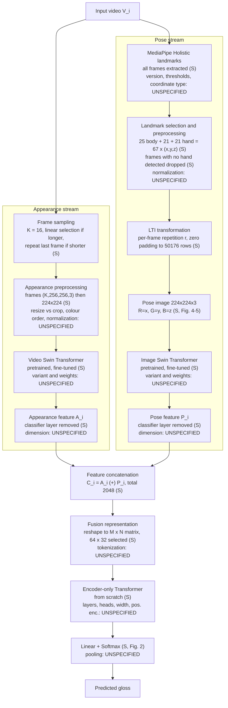
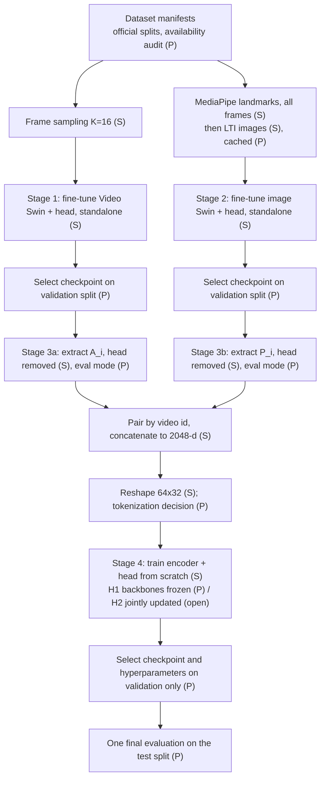
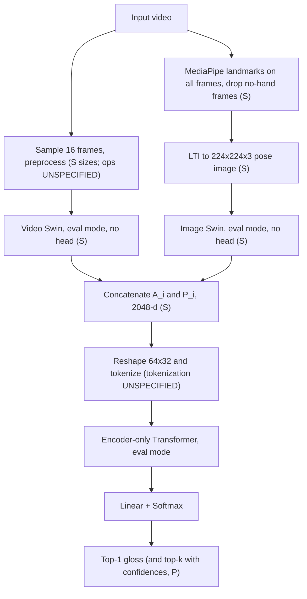

# Phase 1 — Research Paper and Methodology Audit

**Project:** A Two-Stream Appearance–Pose Deep Learning Framework for Isolated Sign Language Recognition on WLASL100 and WLASL300
**Audited paper:** Alkhoraif, Alsulaiman, Abdul, Bencherif — *Ensemble transformer-based word-level sign language recognition with multi-modal input fusion*, Journal of Engineering Research 14 (2026) 738–747
**Document status:** Draft v0.1 — audit of the paper only. Nothing in this document has been reproduced, trained or validated.
**Audit date:** 2026-10-20

---

## 0. Reading conventions

### 0.1 Page numbering

The uploaded PDF has 10 pages. The journal running header gives the printed range **738–747**, so **PDF page *n* = printed page 737 + *n*** (PDF p. 1 = printed p. 738; PDF p. 10 = printed p. 747). The footer number is not printed on the first page. **All page references below are printed pages.**

### 0.2 Section references

The PDF headings are **unnumbered** (Introduction, Related work, Proposed methodology, Experimental results, Conclusion), although the text cross-refers to "Section 2–5" and "Section 4.1". Evidence is therefore cited by **heading name + printed page**, plus table/figure number. The paper contains **no numbered equations**. Its only formulas are inline: $D=\{V^i,G^i\}_{i=1}^{N}$, $A^i\in\mathbb{R}^{M\times1}$, $P^i\in\mathbb{R}^{N\times1}$, $C^i=A^i\oplus P^i$, and $r=\lfloor S/(L\cdot Q)\rfloor$ (in the LTI algorithm box).

### 0.3 Evidence-status tags

| Tag | Meaning |
|---|---|
| **[S]** | Explicitly stated by the paper |
| **[I]** | Reasonably inferred from the paper (inference path given) |
| **[U]** | Not specified by the paper |
| **[X]** | Inconsistency or contradiction inside the paper (reported, not silently resolved) |
| **[P]** | Proposed implementation decision — a project choice requiring verification, not a paper requirement |
| **[E]** | External evidence (listed under *Supplementary Sources*); never used to fill a paper gap silently |

Evidence labels look like `[Ev: Table 6, p. 745]`. Issue IDs are `R-nn` (risk register, Section 14) and `X-nn` (inconsistency, Section 14.2).

---

## 1. Paper identification and research context

### 1.1 Bibliographic record

| Field | Value | Evidence |
|---|---|---|
| Title | Ensemble transformer-based word-level sign language recognition with multi-modal input fusion | p. 738 |
| Authors | Abdulelah Ali Alkhoraif (corresponding), Mansour Alsulaiman, Wadood Abdul, Mohamed Bencherif | p. 738 |
| Affiliation | Dept. of Computer Engineering, College of Computer and Information Sciences, King Saud University, Riyadh | p. 738 |
| Journal | Journal of Engineering Research (Elsevier, on behalf of Kuwait University) | p. 738 |
| Year / volume / pages | 2026 / vol. 14 / pp. 738–747 | p. 738 |
| Issue number | **[U]** not shown in the PDF | — |
| DOI | 10.1016/j.jer.2025.07.006 | p. 738 |
| Received / revised / accepted / online | 9 Jan 2025 / 16 Jun 2025 / 29 Jul 2025 / 31 Jul 2025 | p. 738 |
| Licence | CC BY 4.0 (open access) | p. 738 |
| Funding | King Saud University ORF-2025-1051 | p. 746 |
| Code / data availability statement | **[U]** none found anywhere in the PDF | — |

Note: the online date (2025) differs from the volume year (2026); this is normal for early-access articles and is not a discrepancy.

### 1.2 What the authors state

| Item | Authors' statement | Evidence |
|---|---|---|
| Research problem | Automatic recognition of gloss-level isolated signs; the stated core drawback is extracting valuable, compact features from raw video and skeleton joints | Abstract, p. 738 |
| Motivation | Communication barrier for hearing/speech-impaired people; prior ISR methods use hand-crafted features, lack temporal modelling, or insufficiently fuse appearance and pose | Introduction, pp. 738–739 |
| Contribution 1 | Appearance model: features from preprocessed K frames via Video Swin Transformer; used both for classification and as fusion input | Introduction, p. 739 |
| Contribution 2 | Landmarks-to-Image (LTI) conversion, classified with an image Swin Transformer; also supplies a fusion feature vector | Introduction, p. 739 |
| Contribution 3 | Two-stream architecture: both feature vectors concatenated into one vector and fed to an encoder-only Transformer | Introduction, p. 739 |
| Contribution 4 | Extensive experiments on WLASL, MSASL and ASL Citizen; first evaluation on ASL Citizen100/300 | Introduction, p. 739 |
| Headline result | 93.51 % / 92.56 % / 86.53 % top-1 on WLASL100 / MSASL100 / ASL Citizen100 | Abstract, p. 738; Table 9, p. 745 |
| Acknowledged limitation | Model efficiency for large gloss sets (WLASL1000/2000) remains a limitation; future work on inference time and scalability | Conclusion, pp. 745–746 |

**Main research question.** The paper does not state a formal research question. **[I]** From the contributions and conclusion, the implied question is: *does fusing a Video-Swin appearance feature with a Swin feature of an LTI pose image, through an encoder-only Transformer trained from scratch, improve top-1 isolated-sign accuracy over either stream alone and over prior methods?*

**Task definition.** Isolated sign recognition (ISR): classify one video clip into one gloss class `[Ev: Introduction, pp. 738–739]`.

**Scope.** Word-level, American Sign Language, closed vocabulary of 100/300 (WLASL), 100/200 (MSASL), 100/300 (ASL Citizen) glosses `[Ev: Table 1, p. 743]`. The authors do not claim sentence-level translation or open-vocabulary recognition.

### 1.3 Interpretation (mine, not the authors')

- The word "ensemble" is used for **feature-level fusion with a learned Transformer encoder**, not for averaging independent predictions. Treat "ensemble" in the paper as "fused two-stream model" `[Ev: Proposed methodology, p. 740]`.
- The abstract's three headline numbers are all from the **smallest (100-class) subset** of each dataset. The 300/200-class numbers are lower (Table 9).
- Several "state-of-the-art" claims rest on thin margins (e.g. 93.51 vs 93.08 on WLASL100 = 0.43 pp, about one test video; see Section 13.4). The paper reports no repeated runs, variance, or confidence intervals **[U]**.
- The conclusion's causal narrative (LTI "improves temporal coherence") is stronger than the ablations support (Section 12).

---

## 2. Problem formulation

**Isolated vs continuous SLR.** ISR classifies an individual video recording into a gloss; CSR classifies whole sentences containing multiple glosses; ISR is described as the foundation of CSR `[Ev: Introduction, pp. 738–739]`. This project, like the paper, addresses **ISR only**. It does not translate unrestricted sign language into sentences.

**Gloss.** The written form of a sign's meaning; one gloss can map to one or several spoken-language words `[Ev: p. 739, Fig. 1]`. In the experiments a **gloss is a class label**: each video $V^i$ has exactly one gloss $G^i$, and the label set has $C\in\{100,300\}$ classes for WLASL `[Ev: Proposed methodology, p. 740; Table 2, p. 744]`.

**Notation.** Using the paper's dataset definition and a cleaned-up notation of mine (the paper's $M,N$ are overloaded; see 8.2):

| Symbol | Meaning | Source |
|---|---|---|
| $D=\{(V^i,G^i)\}_{i=1}^{N}$ | dataset of videos and glosses (the paper's $N$ = number of samples) | [S] p. 740 |
| $y_i\in\{1,\dots,C\}$ | integer class index of $G^i$ | [P] notation |
| $a_i=f_{\text{app}}(V^i)\in\mathbb{R}^{d_A}$ | appearance feature, classification layer removed (paper: $A^i\in\mathbb{R}^{M\times1}$) | [S] p. 740 |
| $p_i=f_{\text{pose}}(\mathrm{LTI}(V^i))\in\mathbb{R}^{d_P}$ | pose feature (paper: $P^i\in\mathbb{R}^{N\times1}$) | [S] p. 740 |
| $c_i=a_i\oplus p_i$ | concatenation; the paper's total dimension is **2048** | [S] p. 740, p. 744 |
| $Z_i=\mathrm{reshape}(c_i)\in\mathbb{R}^{H\times W}$ | matrix; selected $H\times W=64\times32$ | [S] pp. 740, 743–745 |
| $\hat y_i=\arg\max_k \mathrm{softmax}\big(W\,g(\mathrm{Enc}(\mathrm{tok}(Z_i)))\big)_k$ | encoder output, pooled by an unspecified $g$, then Linear + Softmax | Fig. 2 [S]; $g$, tok **[U]** |

**From a video to one prediction.** A video is turned into a fixed-size appearance tensor and a fixed-size pose image; each is encoded by a Swin backbone; the two feature vectors are concatenated, reshaped and passed through an encoder-only Transformer whose output goes to a Linear+Softmax head over the gloss set `[Ev: Fig. 2, p. 741]`.

**Why appearance and pose are complementary.** *Authors' rationale:* sign meaning depends on hand shape, position, movement and facial expression `[Ev: p. 739]`; appearance models capture those cues from pixels, while pose models suppress the effects of environment, clothing and skin tone `[Ev: Related work, pp. 739–740]`. *Interpretation:* appearance carries fine hand-shape texture but is nuisance-sensitive; pose carries geometry and trajectory but cannot see finger detail below landmark accuracy and, here, drops face landmarks (Section 5).

---

## 3. Complete proposed architecture

### 3.1 Flowchart (operations as stated; unspecified items marked UNSPECIFIED)



`[Ev: Proposed methodology, pp. 740–741; Fig. 2, p. 741; Figs. 4–5, pp. 742–743]`

### 3.2 Block-by-block contract

| Block | Receives | Produces | Role in the method | Status |
|---|---|---|---|---|
| Frame sampling | decoded video | exactly $K=16$ frames | fixes temporal length for the video transformer | [S] p. 740 |
| Appearance preprocessing | 16 frames | $(16,3,224,224)$-type tensor | spatial standardization | [S] sizes, [U] operations |
| Video Swin | frame tensor | spatiotemporal features | appearance stream backbone; locality bias cited as rationale | [S] p. 740 |
| Appearance feature | Swin output without classifier | $A^i$ | fusion input and (with classifier) standalone predictor | [S] p. 740 |
| MediaPipe Holistic | frames | per-frame pose/hand landmarks | pose source | [S] p. 741 |
| Landmark selection | 543-point output | 67 landmarks × 3 per retained frame | compact skeleton | [S] p. 741 |
| LTI | $(L,67,3)$ matrix | $224\times224\times3$ image | converts a variable-length sequence into an image a vision Swin can consume | [S] p. 741 algorithm |
| Image Swin | pose image | feature $P^i$ | pose stream backbone | [S] p. 742 |
| Concatenation | $A^i,P^i$ | $C^i$ (2048-d) | multimodal fusion input | [S] pp. 740, 743 |
| Reshape/tokenize | $C^i$ | token matrix | prepares encoder input | [S] shape, [U] tokenization |
| Encoder | tokens | encoded tokens | learns cross-modal interactions, from scratch | [S] p. 740 |
| Linear+Softmax | encoder output | class probabilities | gloss prediction | [S] Fig. 2 |

---

## 4. Appearance stream: exact methodology

### 4.1 Specification table

| Item | Paper content | Status | Evidence |
|---|---|---|---|
| Input requirement | A video per gloss, converted to frames; a batch of $n$ videos at a time | [S] | Appearance-based model, p. 740 |
| Frame sampling | If more than $K$ frames: $K$ frames "linearly selected" (read as evenly spaced indices); exact index/rounding rule | [S] / rule [U] | p. 740; p. 744 (Ablation: "selected linearly") |
| Number of frames | $K=16$ (chosen over 8–24 by Table 3) | [S] | pp. 740, 743, 744 |
| Short videos | Last frame repeated until $K$ | [S] | p. 740 |
| Sampling at test time vs train time | Same for both? Temporal jitter augmentation? | [U] | — |
| Resizing | Extracted frames "have dimensions (K,256,256,3)", then reduced to $224\times224$. How native resolution reaches 256 (resize, crop, pad) and how 256 reaches 224 (resize vs crop) | [S] sizes / ops [U] | p. 740 |
| Aspect ratio, bounding boxes, temporal trimming | Whether dataset-provided boxes or segment boundaries were used | [U] | — |
| RGB/BGR | "224 × 224 RGB" stated for appearance frames; channel order of the decoder not stated | [S] RGB / handling [U] | p. 743 |
| Input normalization | mean/std or [0,1] scaling | [U] | — |
| Video Swin variant | Cites Video Swin [41]; Tiny/Small/Base not stated | [U] | p. 740; ref [41] |
| Pretrained weights | "Transfer learning ... adapting a pretrained Swin Transformer through fine-tuning"; source dataset (e.g. Kinetics, ImageNet) not stated | [S] pretrained / identity [U] | p. 740 |
| Classification head | A final "classifier layer" exists in the standalone model and is removed for fusion; its structure (single Linear?) not stated | [S] existence / structure [U] | p. 740 |
| Fine-tuning procedure | Full vs partial fine-tuning, layer-wise rates | [U] | — |
| Feature extraction | Take the backbone output after removing the last classifier layer | [S] | p. 740 |
| Output feature dimension | $A^i\in\mathbb{R}^{M\times1}$; $M$ never given numerically. Only $M\times N=2048$ is stated for the fusion matrix | [U] | pp. 740, 744 |
| Loss | not stated | [U] | — |
| Optimizer | Adam ("All the models were trained with Adam Optimizer") | [S] | p. 744 |
| Learning rate, weight decay, batch size ($n$), epochs, scheduler | not stated | [U] | — |
| Data augmentation | not stated | [U] | — |
| Regularization | not stated | [U] | — |
| Checkpoint selection | not stated | [U] | — |
| Precision / seeds | not stated | [U] | — |
| Framework / hardware | PyTorch; i9-13900K, 64 GB RAM, RTX 4090 (24 GB) | [S] | p. 743 |

### 4.2 Tensor shapes

| Stage | Shape per paper | Note |
|---|---|---|
| Decoded, sampled frames (storage) | $(K,256,256,3)$ = $(16,256,256,3)$, channels-last | [S] p. 740 |
| Resized frames | $(K,224,224,3)$ | [I] |
| Batch input as printed | "$(n,K,3,224,224)$" — the PDF text reads "(n, K,3224,224)", an evident typographical fusion of $3$ and $224$ | [S]/[X], p. 740 |
| Layout required by an implementation | Depends on the chosen Video Swin code. The paper's printed layout is $(n,T,C,H,W)$; PyTorch/torchvision video preset transforms accept $(B,T,C,H,W)$ **[E]**, but the layout the *model's forward pass* expects must be read from the chosen implementation's source and unit-tested | [P] |

**Proposal [P].** Keep a single, documented storage layout (`T,H,W,C`, uint8) on disk/in the dataset, and convert to the model layout in one place (a thin adapter module) covered by a shape-and-value unit test. Use the pretrained weights' own official preprocessing (mean/std, resize policy) as the default; the paper is silent, so this is a project decision to be logged as a deviation-risk, not a paper requirement.

---

## 5. Pose extraction and landmark representation

### 5.1 Specification table

| Item | Paper content | Status | Evidence |
|---|---|---|---|
| Why pose | Suppresses effects of environment, clothing, skin tone; computationally lighter; captures hand movement and body posture | [S] | Related work, pp. 739–740 |
| Extractor | MediaPipe Holistic [35]; chosen over OpenPose for "efficiency, flexibility, and accuracy" | [S] | Pose extraction, pp. 740–741 |
| Holistic topology | "540 + 3D landmarks": 33 body, 21 per hand, 468 face | [S] | p. 741 |
| Retained landmarks | **25 body landmarks (indexed 0–24) + 21 + 21 hand landmarks = 67** | [S] | p. 741 |
| Verification of 25+21+21 | $25+21+21=67$ ✔; matches $Q=67$ in the algorithm box and "(K, 67, 3)" | [S] ✔ | pp. 741 |
| Excluded | All 468 face landmarks and body indices 25–32; justification: face information is available "from the selected body key points from 0 to 10" | [S] | p. 741 |
| Coordinates | $x,y,z$ per landmark | [S] | p. 741 |
| Coordinate *type* | Normalized image coordinates vs world coordinates (both exist in Holistic output **[E]**) | [U] | — |
| Temporal representation | Matrix of shape "$(K,67,3)$ where $K$ is the number of frames for each video" | [S] | p. 741 |
| Frames used | **All frames** of the video are extracted for the pose model (contrast: 16 for appearance) | [S] | p. 744 ("Experimental settings", continued) |
| Frames with no hands | Dropped: a frame is kept only if left, right, or both hands are detected; hence $L\le K$ | [S] | Algorithm step 2, p. 741 |
| One hand detected | Treatment of the absent hand's 21 landmarks (zeros? NaN? previous frame?) | [U] | — |
| Body not detected | Not addressed | [U] | — |
| Videos with zero retained frames | Not addressed ($L=0$ would divide by zero in step 3) | [U] | — |
| Landmark ordering | "25 + 21 + 21" suggests body, then hands; **which hand comes first is not stated** | [I] body first / [U] hand order | p. 741 |
| Normalization | Text says landmarks are converted to an image "after normalization using the proposed LTI algorithm", but **the LTI algorithm contains no normalization step** | [X] | p. 741 text vs algorithm box |
| Confidence/visibility thresholds | Not stated. The text mentions a per-hand "hand flag" probability, but not that it is used or thresholded | [U] | p. 741 |
| MediaPipe version/API/parameters | Reference [35] cites "Accessed Online, 17 February 2024"; legacy solution vs Tasks API, model complexity, detection/tracking confidences not given | [U] | ref [35], p. 746 |
| Smoothing/interpolation | Not stated | [U] | — |

### 5.2 Expected shapes (derived only where justified)

| Quantity | Shape | Justification |
|---|---|---|
| Per-frame retained landmarks | $(67,3)$ | [S] |
| Raw per-video matrix (as the text says) | $(K_{\text{video}},67,3)$ | [S] p. 741 |
| After hand-based frame rejection | $(L,67,3)$, $L\le K_{\text{video}}$ | [S] algorithm output |

**Notation warning [X].** The symbol $K$ means two different things: the fixed appearance frame count ($K=16$, p. 740) and the variable number of video frames in the LTI algorithm ("K is the variant number of video frames in each video", p. 741). In Section 5 and 6 this document writes $K_{\text{video}}$ for the latter.

### 5.3 Uncertainties that can change results

1. Treatment of single-hand frames and of frames with undetected hands (changes $L$ and the content of the image).
2. Normalized-image vs world coordinates, and whether any scaling to a pixel range occurs.
3. Left/right hand ordering within each frame block.
4. MediaPipe version and confidence parameters (change which frames survive).

---

## 6. Landmark-to-Image (LTI) algorithm

### 6.1 What the paper provides

The paper gives (a) a pseudocode box titled "3D Landmark Extraction and Reshaping – landmarks to image (LTI)" `[Ev: Algorithm box, p. 741]`; (b) two figures, Fig. 4 (extraction) `[p. 742]` and Fig. 5 (conversion) `[p. 743]`; (c) a motivation paragraph `[Ev: p. 742]`. There is **no numbered equation**; the only formula is $r=\lfloor S/(L\cdot Q)\rfloor$.

### 6.2 Paper pseudocode, reproduced (not corrected)

```text
Initialize:  S = RGB image size (S = 224x224);  Q = number of landmarks per frame (Q = 67)
Input:       video V, length K frames (K is the variant number of frames in each video)
1  Separate video into K frames
2  Call MediaPipe to extract landmarks from each frame
     for each frame:
       if left hand, right hand, or both hands landmarks detected:
         find Q x 3 marks
         add these Q x 3 landmarks to the Landmarks Matrix
   Output: L x Q x 3 matrix; L = number of frames that have landmarks (L <= K)
3  if L*Q < S:
       calculate r = floor(S / (L*Q))
   else:
       delete landmarks for some frames such that L <= S/Q
4  for each frame in L:
       repeat the frame r times
       concatenate the repeated frames
   Output: concatenated frames matrix (CFM), L x r x Q x 3
5  if CFM != S:
       add zeros to CFM till S
6  Reshape CFM to S x 3 image
```
`[Ev: Algorithm box, p. 741; Fig. 5, p. 743]`

### 6.3 Reconstruction (my restatement, derived from the box and Fig. 5; **not** a paper equation)

Let $S=224\cdot224=50176$, $Q=67$, and $X\in\mathbb{R}^{L\times Q\times3}$ be the retained landmark tensor in temporal order.

1. If $LQ<S$: $r=\lfloor S/(LQ)\rfloor$. Each frame block $X_l\in\mathbb{R}^{Q\times3}$ is repeated $r$ times consecutively. The row index of landmark $q$ in repetition $j$ of frame $l$ is $(l\,r+j)\,Q+q$, so the stacked matrix is $\mathrm{CFM}\in\mathbb{R}^{(L\,r\,Q)\times3}$ **[I]** (consistent with Fig. 5's "concatenate → repeat → concatenate").
2. Rows $L\,r\,Q+1,\dots,S$ are filled with zeros, giving a $(50176\times3)$ matrix. Fig. 5 explicitly labels the target a "zero matrix 50176 × 3" and the text "Replacing Landmarks to a zero 50176*3 matrix" `[Ev: Fig. 5, p. 743]`.
3. The $(50176\times3)$ matrix is reshaped into a $224\times224\times3$ image; each of the three columns becomes one colour channel. Figs. 4–5 label the red layer with $x$ values, green with $y$, blue with $z$ `[Ev: Figs. 4–5]`, and the text states "each channel of the image explicitly maps to one spatial dimension" `[Ev: p. 742]`.

**Reshape order [I]/[U].** The paper says only "Reshape CFM to Sx3 image". The literal reading is a row-major reshape so that pixel $(h,w)$ holds row $224h+w$ of CFM, with channel $c$ = coordinate $c$. Column-major order, or reshaping the flattened array straight to $(3,224,224)$, would mix coordinates across channels and contradict the stated channel mapping; both must be excluded by a unit test (Section 15, LTI row).

### 6.4 Inputs, outputs and organization

| Aspect | Specification | Status |
|---|---|---|
| Input | one video's per-frame landmarks | [S] |
| Intermediate | $(L,67,3)$ | [S] |
| Output | $224\times224\times3$ image (Fig. 4: "224x224x3 image size") | [S] |
| Temporal handling | frame order preserved; frames without hands removed; no resampling to a fixed $L$ | [S]/[I] |
| Landmark order within a frame | body 0–24, then hands (hand order [U]) | [I]/[U] |
| Frame repetition | **per frame**, consecutively, $r$ times (ablation: this beats all-frames repetition, Table 5) | [S] |
| Padding | zeros appended to reach $S$ rows | [S] |
| Coordinate scaling, clipping, rounding, dtype (float vs 8-bit) | none stated | [U] |
| Missing landmarks | zero values are indistinguishable from padding; policy [U] | [U] |
| Frame rejection beyond "no hand" | the `else` branch deletes frames "for some frames" without saying which | [U] |

### 6.5 Ambiguities in the algorithm itself (all reported, none silently fixed)

| # | Ambiguity | Why it matters |
|---|---|---|
| a | In the `else` branch ($LQ\ge S$, i.e. $L\ge749$ because $67\times748=50116<50176\le67\times749=50183$), $r$ is never assigned before step 4 | after deletion $L\le748$, so $r\ge1$ would follow if recomputed; the paper does not say |
| b | "delete landmarks for some frames" — which frames (uniform, first, random)? | changes content for long videos |
| c | Step 5 compares a matrix to a scalar ("CFM ≠ S") | read as "has fewer than $S$ rows" **[I]** |
| d | Step 6 says "Sx3 image" with $S$ defined as "(224x224)" | read as $(224\cdot224)\times3$ **[I]** |
| e | $K$ used for variable length here vs. fixed 16 elsewhere | notation only |
| f | Text claims "normalization", algorithm has none | scaling of pixel values undefined (X-05) |
| g | $L=0$ case undefined | needs a policy before dataset processing |
| h | Ablation (Table 5) "LTI without repetition" is described as "setting $r$ to zero ... and skipping step 4"; $r=0$ would yield an empty matrix if step 4 were executed | read as "no repetition, zero-pad after concatenation" **[I]** |

### 6.6 Worked examples (my arithmetic, for test design — not from the paper)

| $L$ (retained frames) | $LQ$ | $r$ | Rows filled | Zero rows | Zero fraction |
|---:|---:|---:|---:|---:|---:|
| 1 | 67 | 748 | 50116 | 60 | 0.1 % |
| 60 | 4020 | 12 | 48240 | 1936 | 3.9 % |
| 100 | 6700 | 7 | 46900 | 3276 | 6.5 % |
| 748 | 50116 | 1 | 50116 | 60 | 0.1 % |

Without repetition (Table 5 ablation), $L=100$ fills only $6700/50176=13.4\,\%$ of the image rows. Since $224 \bmod 67 = 23$, a frame's 67-row block does **not** align with image-row boundaries (about 3.34 frames per 224-pixel row, without repetition).

### 6.7 How LTI differs from vector concatenation, and why the authors use it

*Authors:* standard pipelines keep only $(x,y)$ and flatten per-frame coordinates into a 1-D vector, yielding a matrix with one row per frame `[Ev: pp. 741–742]`; LTI "encodes full 3D landmark information ... as an RGB image", keeps depth, and uses frame repetition to reach a fixed resolution `[Ev: p. 742]`.

*Audit notes:* (i) the paper's own vector baseline in Table 4 also flattens $(67,3)$, i.e. **includes $z$** `[Ev: p. 744]`, so the measured gain cannot be attributed to "preserving depth"; (ii) that baseline feeds a *Transformer Encoder* rather than a Swin, so representation and backbone differ (Section 12).

### 6.8 Information possibly preserved or lost (interpretation)

| Preserved | Lost or distorted |
|---|---|
| $x,y,z$ of 67 landmarks for each retained frame; temporal order along the raster scan | frames with no hand; hand-detection confidence; face landmarks except body 0–10; true duration/frame-rate (only implicit via $r$ and the zero-padded tail); 2-D neighbourhood meaning (raster order interleaves different frames and landmarks inside a Swin window); possible 8-bit quantization (unspecified) |

---

## 7. Pose Swin Transformer

| Item | Paper content | Status | Evidence |
|---|---|---|---|
| Input | $224\times224\times3$ LTI image | [S] | pp. 741–742 |
| Backbone | "pretrained image Swin Transformer" [48] (Swin, ICCV 2021) | [S] | p. 742 |
| Variant (T/S/B/L) | not stated | [U] | — |
| Pretraining | "pretrained"; dataset not stated | [S]/[U] | p. 742 |
| Classification head | exists in standalone model; removed for fusion | [S] | p. 743 |
| Fine-tuning | implied by "adapting a pretrained image Swin"; scope [U] | [S]/[U] | p. 740 |
| Loss | not stated | [U] | — |
| Optimizer | Adam (all models) | [S] | p. 744 |
| Hyperparameters, augmentation, scheduler, checkpointing | not stated | [U] | — |
| Output feature | $P^i\in\mathbb{R}^{N\times1}$, $N$ not given numerically | [U] | p. 740 |
| Difference from appearance branch | different backbone type (2-D image Swin vs. Video Swin) and input (single synthetic image vs. 16-frame clip); whether variant/settings match **is not stated** and must not be assumed | [S]/[U] | pp. 740–743 |

**Citation inconsistency [X].** The Image Swin paragraph says its effectiveness "was demonstrated in the experimental results in Table 7, where it outperformed conventional CNNs and LSTM-based baselines" `[Ev: p. 742]`. Table 7 is the **appearance** comparison; the pose comparison is Table 8, which lists graph/GRU/Transformer-based pose models and is where the pose stream is said to be evaluated `[Ev: p. 740, Table 8, p. 745]`.

**Interpretation.** The paper repeatedly says the pose Swin learns "spatiotemporal patterns" from the LTI image; the image has no genuine 2-D spatial or temporal structure beyond raster order, so Swin's window attention operates on a synthetic layout. This is an observation, not a flaw to be "fixed": the architecture must be preserved.

---

## 8. Multimodal fusion Transformer

### 8.1 Specification and verification table

| Item | Paper content | Status | Evidence |
|---|---|---|---|
| Both streams' classifier layers removed | yes | [S] | p. 740 |
| Concatenation | $C^i=A^i\oplus P^i$ | [S] | pp. 740, 743 |
| Total dimension | $M\times N=2048$ | [S] | p. 744 (Ablation: patch sizes) |
| **"Two 1024-d features"** | **Not stated anywhere.** The paper never gives $d_A$ or $d_P$ numerically. $1024+1024=2048$ is **consistent** with the 2048 total but is an unverified assumption | [U] | pp. 740, 743, 744 |
| Reshape | to an $M\times N$ 2D matrix "for tokenization" | [S] | p. 743 |
| Selected configuration | **64 × 32** ($=2048$ ✔) | [S] | p. 743; Table 6, p. 745 |
| Candidate grid | 8×256, 16×128, 32×64, 64×32, 128×16, 256×8 (each product = 2048 ✔) | [S] | Table 6, p. 745 |
| Normalization/projection before encoder | not stated | [U] | — |
| Token construction | "The C vector was divided into patches" with the constraint that the matrix size is $M\times N$; the patch size and the matrix size are treated as the same quantity | [S]/ambiguous | p. 743 |
| Sequence length, embedding dimension | **not stated** | [U] | — |
| Class token, positional encoding | not stated in text; Fig. 2 shows an "Embedded Patches" block | [U] | Fig. 2, p. 741 |
| Encoder block structure | Fig. 2: Norm → Multi-Head Attention (+residual) → Norm → MLP (+residual), repeated "L×", then Linear → Softmax (pre-normalization layout) | [S] (figure) | Fig. 2, p. 741 |
| Number of layers $L$, heads, MLP width, activation, dropout | not stated | [U] | — |
| Pooling before Linear head | not stated | [U] | — |
| Weight initialization | "initialized from scratch without pre-trained weights"; scheme (Xavier, truncated normal, …) not stated | [S]/[U] | p. 740 |
| Loss, learning rate, batch, epochs, scheduler | not stated; Adam only | [U] | p. 744 |

### 8.2 Notation conflict [X]

The paper first defines $A^i\in\mathbb{R}^{M\times1}$ and $P^i\in\mathbb{R}^{N\times1}$ (so $M,N$ are *feature lengths*), then $C^i=A^i\oplus P^i\in\mathbb{R}^{(M\times N)\times1}$. Concatenation gives length $M+N$, not $M\times N$. Later $M\times N$ denotes the *matrix* shape ($64\times32$). So $M,N$ change meaning between pages 740 and 743–744. **Only the total 2048 and the matrix shape 64×32 are usable facts.**

### 8.3 The tokenization gap

**What the paper establishes:** a 2048-vector becomes a $64\times32$ (or $M\times N$) matrix; this matrix is "divided into patches"; Table 6 varies the shape.

**What is missing:** (i) whether tokens are the matrix *rows*, *columns*, or sub-blocks; (ii) the sequence length; (iii) the embedding width and whether a linear projection maps each token to it; (iv) whether a class token or pooling is used; (v) positional encoding type. Because the whole matrix has only 2048 entries and the paper equates "patch size" with "matrix size", a literal reading would give **one** patch (sequence length 1) — a degenerate encoder for which self-attention is vacuous. The grid in Table 6 therefore must refer to some token layout that the text never spells out. Fig. 2 shows a small grid of cells under "Tokenization" feeding "Embedded Patches"; it carries no dimensions or labels (some cells are shaded differently, without explanation in the caption).

**Candidate alternatives — proposals [P], to be tested only after the gap above is recorded:**

| Option | Token layout for $64\times32$ | Sequence length / token width | Notes |
|---|---|---|---|
| T-A | rows are tokens | 64 / 32 | each token then linearly projected to a model width $d$ |
| T-B | columns are tokens | 32 / 64 | transpose of T-A |
| T-C | contiguous blocks of the flattened vector | $2048/b$ / $b$ | $b$ is a free choice; no paper support |

Selection rule [P]: train the fusion stage on cached features (cheap) for T-A/T-B across the **whole Table 6 grid** on the validation split only, and keep the layout whose accuracy-vs-shape *trend* resembles Table 6 (peak at 64×32, drop at 8×256 and 256×8). Resemblance of the trend is a plausibility check, **not** proof of equivalence. All remaining hyperparameters ($d$, layers, heads, MLP width, dropout, pooling, positional encoding) are project choices and must be logged as deviations from an unspecified baseline.

### 8.4 Joint vs separate training — what the text supports

- Evidence for **separate** stages: Tables 7 and 8 report the two branches as standalone classifiers; the fusion model then "removes their respective classification layers" and reuses their features `[Ev: p. 740]`.
- Evidence for ambiguity: "The Ensemble model was trained end from scratch on the benchmark datasets" `[Ev: p. 743]` — the phrase is unclear (it may mean "end-to-end from scratch" or merely that the encoder starts from random weights). The text calling the encoder "initialized from scratch without pre-trained weights" `[Ev: p. 740]` supports reading it as encoder-only.
- Whether backbones are **frozen** while the encoder trains is **[U]**.

This document therefore treats two hypotheses as open (Section 9): **H1** frozen/cached branch features + encoder trained from scratch; **H2** backbones and encoder updated together. End-to-end joint training is **not** assumed.

---

## 9. Training and inference workflow

### 9.1 Stage table

| Stage | Trainable parameters | Not updated | Input → output | What the paper supports |
|---|---|---|---|---|
| 1. Appearance branch (standalone) | Video Swin (scope of fine-tuning **[U]**) + classification layer | — | 16-frame clips → gloss logits (Table 7) | [S] standalone use, p. 740 |
| 2. Pose branch (standalone) | Image Swin (scope **[U]**) + classification layer | — | LTI images → gloss logits (Table 8) | [S] standalone use, p. 743 |
| 3. Feature extraction | none | all | video / LTI image → $A^i$, $P^i$ (classifier removed) | [S] "removing the last classifier layer"; **before or after fine-tuning is not stated**; fusing a standalone-trained model implies *after* **[I]** |
| 4. Fusion Transformer | encoder + Linear head (random init) under **H1**; additionally both backbones under **H2** | backbones under H1 | $c_i$ → reshape → tokens → class probabilities (Table 9) | [S] encoder from scratch; H1/H2 **[U]** |
| 5. Inference | none | all | video → predicted gloss | [I] same path as stages 3–4 |

### 9.2 Open question: joint vs separate training

The paper never states whether backbones are frozen in stage 4, whether branch features are extracted with augmentation on/off, or in which mode (train/eval). The phrase "trained end from scratch" (p. 743) is unclear. **Decision to be recorded before coding [P]:** implement **H1** first (it is the only reading consistent with "standalone classifiers whose heads are removed", and it is the only one trainable on the available hardware), log it as an *interpretation*, and treat H2 as a documented, optional follow-up.

**In-sample feature shift (risk, not a paper statement).** Under H1 the backbones are fine-tuned on the training split, so training-set features are in-sample and typically more separable than validation/test features. The paper does not say how this was handled. Options to record as decisions: (a) paper-literal — extract training features from the fine-tuned backbones; (b) deviation — out-of-fold features. Any choice other than (a) is a deviation and must be logged.

### 9.3 Training workflow



### 9.4 Final inference workflow



---

## 10. Dataset and subset protocol

### 10.1 Verification of the supplied counts

| Subset | Classes | Train | Val | Test | Sum of splits | Table 1 videos | Match |
|---|---:|---:|---:|---:|---:|---:|:---:|
| WLASL100 | 100 | 1442 | 338 | 258 | 2038 | 2038 | ✔ |
| WLASL300 | 300 | 3548 | 901 | 668 | 5117 | 5117 | ✔ |

`[Ev: Table 2, p. 744 (classes and splits); Table 1, p. 743 (videos)]`. Every value in the supplied table is present in the paper and the totals are arithmetically consistent (my sums: 1442+338+258 = 2038; 3548+901+668 = 5117). Table 2 has no *Total* column; the totals come from Table 1. The same consistency holds for all other subsets in Table 2 (ASL Citizen100/300, MSASL100/200). **No numerical discrepancy was found in the dataset counts.** Split proportions (derived): WLASL100 70.8 / 16.6 / 12.7 %; WLASL300 69.3 / 17.6 / 13.0 %. Table 1 also gives 97 and 100 signers for WLASL100/300 and 20.4 and 17.1 videos per sign (consistent with 2038/100 and 5117/300).

### 10.2 Protocol questions

| Question | Paper | Status |
|---|---|---|
| Definition of WLASL100/300 | "the top 100 and 300 most frequently used glosses" | [S] p. 743 |
| Selection protocol (ranking rule, ties) | not described beyond "most frequently used" | [U] |
| Class lists provided | no | [U] |
| Official splits used | the paper says splits are "detailed in Table 2" and never says "official". The official WLASL repository distributes splits files separately **[E]**; whether Table 2 equals them must be checked against those files | [U] |
| All listed videos usable | not discussed; the Table 1 totals equal the *metadata* counts, so it is unclear whether every video was downloadable and decodable | [U] |
| Class imbalance handling | imbalance is listed as a challenge (p. 743); no weighting, sampling or augmentation is described | [U] |
| Use of dataset boxes / segment boundaries | not stated | [U] |
| Preprocessing before 256×256 | not stated | [U] |

**Availability warning.** The paper describes WLASL as "over 21,083 video samples" (p. 743). The official repository defines the subsets as the top-K glosses of its metadata file and distributes videos through source links or on request **[E]**; a public mirror lists a smaller sample count (11,980) **[E]**, which suggests the downloadable set can be much smaller than the metadata. The mirror is not authoritative; it only shows that *metadata instances ≠ usable videos*, so the audit must count what can actually be obtained and decoded.

### 10.3 Unresolved replication questions

1. How exactly were the top-100/300 glosses ranked, and can the class lists be reconstructed from the official metadata?
2. Do Table 2's counts equal the official split assignments, and how many of those videos are obtainable?
3. Were bounding boxes or temporal segment boundaries used?

### 10.4 What the dataset audit must record [P]

Per video: `video_id`, gloss, class index, split, source URL/provenance, local path, file hash, downloaded (yes/no), decodable (yes/no), frame count, fps, width×height, duration, signer id if available, MediaPipe statistics (frames with any hand, frames with both hands, retained $L$), and rejection reason. Per subset: classes, per-split counts of **metadata vs obtained vs usable**, per-class support (min/median/max), and a diff against Table 2. Reported accuracy must always state which manifest it was computed on.

---

## 11. Experimental settings and reported results

### 11.1 Settings extracted

| Setting | Value | Evidence |
|---|---|---|
| Framework | PyTorch | p. 743 |
| Hardware | Desktop, 13th Gen Intel Core i9-13900K (3.00 GHz), 64 GB RAM, NVIDIA GeForce RTX 4090 (24 GB GDDR6X) | p. 743 |
| Appearance input | 16 frames per video, 224×224 RGB | p. 743 |
| Pose input | all frames per video → landmarks | pp. 743–744 |
| Optimizer | Adam, all models | p. 744 |
| Selected K / patch size | $K=16$; patch $64\times32$ | pp. 740, 743 |
| Learning rate, batch size, epochs, scheduler, loss, augmentation, regularization, seeds, checkpoint rule | **not stated** | — |
| Reported metric | top-1 accuracy only ("the Top-1 accuracy result was shown in Four tables") | p. 744 |
| Evaluation split for reported numbers | **not stated** (train/val/test counts are in Table 2 but the tables do not say which split is scored) | — |

### 11.2 Verification of the supplied WLASL results

| Subset | Appearance (standalone) | Pose (standalone) | Ensemble (final) | Verified? |
|---|---|---|---|:---:|
| WLASL100 | **85.60** — Table 7 (p. 745); same value as K=16 in Table 3 (p. 744) | **74.26** — Table 8 (p. 745); same as "LTI (Proposed)" in Table 4 and "Per Frame Repetition (Default LTI)" in Table 5 (p. 744) | **93.51** — Table 9 (p. 745); same as 64×32 in Table 6 and "With LTI" in Table 10 (p. 745) | ✔ |
| WLASL300 | **77.34** — Tables 7 and 3 | **69.57** — Tables 8, 4, 5 | **88.53** — Tables 9, 6, 10 | ✔ |

All six values are present and **internally consistent across the tables in which they recur.** Result types: Table 7 = standalone appearance result; Table 8 = standalone pose result; Table 9 = final fusion model; Tables 3, 4, 5, 6, 10 = ablation tables whose "chosen-configuration" row reuses those numbers.

Differences supported by the numbers (my arithmetic): WLASL100 ensemble − appearance = +7.91 pp, − pose = +19.25 pp; WLASL300 ensemble − appearance = +11.19 pp, − pose = +18.96 pp.

### 11.3 Can the reported percentages be test accuracies on the stated splits?

A top-1 accuracy on $n$ videos can only be $100\,k/n$ for an integer $k$. I tested each reported WLASL value against the split sizes in Table 2 (my computation):

| Reported | Nearest on test split | Nearest on validation split |
|---|---|---|
| WLASL100 85.60 | 221/258 = 85.66 | 289/338 = 85.50 |
| WLASL100 74.26 | 192/258 = 74.42 | **251/338 = 74.26** |
| WLASL100 93.51 | 241/258 = 93.41 | 316/338 = 93.49 |
| WLASL300 77.34 | 517/668 = 77.40 | 697/901 = 77.36 |
| WLASL300 69.57 | 465/668 = 69.61 | 627/901 = 69.59 |
| WLASL300 88.53 | 591/668 = 88.47 | 798/901 = 88.57 |

With $n=258$ the achievable values are spaced about 0.39 pp apart, and with $n=668$ about 0.15 pp, so a chance match to two decimals is unlikely; **none of the six values equals $k/n$ for the test size, and only one equals $k/n$ for the validation size.** This does not prove an error (possible causes: averaging over runs, per-class mean accuracy, a different denominator or split, rounding, transcription). It means the **evaluation denominator is unresolved (R-04)** and the published numbers should not be treated as reproducible targets until it is clarified. (Matches against the full-dataset size are uninformative because the resolution there is ~0.02 pp.)

### 11.4 All reported headline results (top-1 %)

| Result | WLASL100 | WLASL300 | MSASL100 | MSASL200 | ASL Cit.100 | ASL Cit.300 | Table |
|---|---:|---:|---:|---:|---:|---:|---|
| Appearance | 85.60 | 77.34 | 87.34 | 86.93 | 80.92 | 69.45 | 7 |
| Pose (LTI) | 74.26 | 69.57 | 88.79 | 87.21 | 71.51 | 67.37 | 8 |
| Ensemble | 93.51 | 88.53 | 92.56 | 91.89 | 86.53 | 84.23 | 9 |

Observation: on MSASL100/200 the **pose** stream exceeds the **appearance** stream (88.79 vs 87.34; 87.21 vs 86.93), unlike WLASL and ASL Citizen. Top-5 and any metric other than top-1 are **not reported**.

### 11.5 Baseline comparisons (WLASL columns shown; remaining columns in the paper)

**Table 7 — appearance (p. 745), top-1 %**

| Method | WLASL100 | WLASL300 | MSASL100 | MSASL200 |
|---|---:|---:|---:|---:|
| I3D [18] | 65.89 | 56.14 | "8176" (as printed; decimal point missing, **[X]**) | 81.97 |
| Fusion3 [33] | 75.67 | 68.30 | – | – |
| SignBERT+ [19] | 82.56 | 74.54 | 85.23 | 79.35 |
| TCK [51] | 77.52 | 68.56 | 83.91 | 81.14 |
| Proposed appearance | 85.60 | 77.34 | 87.34 | 86.93 |

**Table 8 — pose (p. 745), top-1 %**

| Method | WLASL100 | WLASL300 | MSASL100 | MSASL200 |
|---|---:|---:|---:|---:|
| ST-GCN [52] | 51.62 | 45.28 | 60.79 | 54.2 |
| Pose-TGCN [18] | 55.43 | 38.32 | – | – |
| GCN-BERT [22] | 60.15 | 42.18 | – | – |
| Pose-GRU [53] | 46.51 | 33.68 | – | – |
| SPOTTER [9] | 63.18 | 43.78 | – | – |
| MASA [54] | 84.47 | 74.33 | 83.19 | 79.70 |
| Sign2Pose [55] | 80.9 | 64.1 | – | – |
| Proposed pose | 74.26 | 69.57 | 88.79 | 87.21 |

**Table 9 — ensemble (p. 745), top-1 %**

| Method | WLASL100 | WLASL300 | MSASL100 | MSASL200 |
|---|---:|---:|---:|---:|
| BEST [56] | 81.63 | 76.12 | 60.79 | 54.2 |
| NLA-SLR [57] | 93.08 | 87.33 | 91.24 | 91.02 |
| SignBERT+ [19] | 83.3 | 75.27 | 89.96 | 87.62 |
| Signgraph [36] | 72.09 | 71.4 | – | – |
| P3D [58] | 78.27 | 67.62 | – | – |
| HMA [59] | – | – | 88.14 | 86.09 |
| **Ensemble model** | **93.51** | **88.53** | **92.56** | **91.89** |

Margins over the strongest listed baseline (NLA-SLR): +0.43, +1.20, +1.32, +0.87 pp. Other discrepancies in these tables (e.g. the BEST row's MSASL entries equal the ST-GCN row's; MASA exceeds the proposed pose model on WLASL100/300; the text's claim about Table 8) are logged as X-items in Section 14.2.

---

## 12. Ablation study audit

The paper states it "conducted four experiments" in the Ablation study, "examined individually while keeping the remaining architecture constant" `[Ev: p. 744]`. A fifth, ensemble-level experiment (with/without LTI, Table 10) appears under *Evaluation* `[Ev: pp. 744–745]`.

### 12.1 Tables (top-1 %, columns WLASL100 / 300, MSASL100 / 200, ASL Cit.100 / 300)

**Table 3 — number of frames $K$ (appearance stream), p. 744**

| K | WL100 | WL300 | MS100 | MS200 | AC100 | AC300 |
|---:|---:|---:|---:|---:|---:|---:|
| 8 | 81.44 | 75.8 | 82.22 | 80.6 | 75.55 | 65.78 |
| 12 | 82.40 | 76.48 | 83.60 | 81.34 | 77.64 | 66.28 |
| **16** | **85.60** | **77.34** | **87.34** | **86.93** | **80.92** | **69.45** |
| 20 | 84.35 | 74.34 | 84.33 | 85.11 | 78.37 | 67.32 |
| 24 | 83.33 | 73.45 | 83.44 | 84.56 | 77.66 | 66.43 |

**Table 4 — pose representation, p. 744**

| Strategy | WL100 | WL300 | MS100 | MS200 | AC100 | AC300 |
|---|---:|---:|---:|---:|---:|---:|
| Vector concatenation | 61.30 | 53.72 | 63.70 | 60.20 | 54.43 | 50.37 |
| LTI (proposed) | 74.26 | 69.57 | 88.79 | 87.21 | 71.51 | 67.37 |

(The quoted improvements 12.96, 15.85, 25.09, 27.01, 17.08, 17.0 pp reproduce exactly from this table.)

**Table 5 — repetition inside LTI, p. 744**

| Strategy | WL100 | WL300 | MS100 | MS200 | AC100 | AC300 |
|---|---:|---:|---:|---:|---:|---:|
| No repetition | 58.73 | 51.40 | 60.24 | 58.73 | 50.30 | 48.25 |
| All-frames repetition | 64.84 | 57.43 | 69.30 | 64.53 | 59.82 | 55.62 |
| Per-frame repetition (default) | 74.26 | 69.57 | 88.79 | 87.21 | 71.51 | 67.37 |

**Table 6 — fusion matrix/patch shape ($M\times N=2048$), p. 745** (the PDF prints "64 £ 32", an evident encoding error for 64 × 32)

| Shape | WL100 | WL300 | MS100 | MS200 | AC100 | AC300 |
|---|---:|---:|---:|---:|---:|---:|
| 8 × 256 | 78.30 | 71.54 | 77.81 | 71.43 | 68.13 | 61.40 |
| 16 × 128 | 86.56 | 79.60 | 84.72 | 84.32 | 80.74 | 78.30 |
| 32 × 64 | 91.46 | 82.90 | 88.54 | 87.27 | 83.12 | 82.61 |
| **64 × 32** | **93.51** | **88.53** | **92.56** | **91.89** | **86.53** | **84.23** |
| 128 × 16 | 90.40 | 83.67 | 87.30 | 86.28 | 82.75 | 80.72 |
| 256 × 8 | 80.56 | 76.60 | 81.72 | 80.54 | 77.10 | 73.86 |

**Table 10 — ensemble without/with LTI, p. 745**

| Variant | WL100 | WL300 | MS100 | MS200 | AC100 | AC300 |
|---|---:|---:|---:|---:|---:|---:|
| Without LTI | 87.75 | 79.20 | 85.23 | 83.55 | 81.54 | 70.10 |
| With LTI | 93.51 | 88.53 | 92.56 | 91.89 | 86.53 | 84.23 |

(Quoted gains 5.76, 9.33, 7.33, 8.34, 4.99, 14.13 pp reproduce exactly.)

### 12.2 Audit per ablation

| Ablation | Question tested | Controlled variable | Reported outcome | What the experiment supports | Limits |
|---|---|---|---|---|---|
| Frames $K$ (Table 3) | Does temporal granularity matter for the appearance model? | $K\in\{8,12,16,20,24\}$ | $K=16$ best in all six columns | $K=16$ is best among tested values for this model, on whatever split is scored | text says $K$ ranged "from 12 to 32 in increments of 4" and that gains beyond 16 were "minimal"; the table has $K=8$ but not 28/32, and accuracy at $K>16$ **drops** relative to $K=16$ in every column, by up to about 3.9 pp (e.g. WLASL300 −3.89, MSASL100 −3.90 at $K=24$) (X-01, X-02). $K$ was selected on the very numbers later reported as results |
| LTI vs vector (Table 4) | Is LTI better than flattening landmarks? | pose representation | LTI +12.96/+15.85 pp on WLASL100/300 | the *LTI + Swin* pose pipeline beats the *vector + Transformer-encoder* pose pipeline | the baseline is "used as input to the Transformer Encoder", i.e. **representation and backbone change together**; the baseline also contains $z$ (so "depth preservation" is not the differentiator); the cited source "as in [61]" does not exist in the reference list (ends at [59]) (X-06) |
| Repetition (Table 5) | Does repetition and its form matter? | step 4 of LTI | per-frame ≫ all-frames ≫ none | per-frame repetition gives higher accuracy than the two alternatives in this pipeline | repetition changes simultaneously the **fraction of non-zero pixels** and the local spatial pattern; "setting $r$ to zero and skipping step 4" is itself ambiguous (6.5-h); WLASL100 and MSASL200 "no repetition" values are identical (58.73), worth a transcription check |
| Patch/matrix shape (Table 6) | Which reshape is best? | $M\times N$ with product 2048 | 64×32 best everywhere; both extremes worst | accuracy is sensitive to the shape under the (unspecified) tokenization | uninterpretable without the tokenization (Section 8.3); selection and reporting use the same numbers; accuracy is non-monotone (peak at 64×32) with no stated mechanism |
| Appearance vs pose vs ensemble (Tables 7–9) | Is fusion better than either stream? | stream(s) | ensemble ≫ either stream on all subsets | fusion by the described model outperforms each standalone stream | **no simpler fusion baseline** (logit averaging, MLP on the concatenated vector) is reported, so the contribution of the *Transformer encoder* itself is not isolated |
| With/without LTI in the ensemble (Table 10) | Does LTI matter in the fused model? | pose stream representation | +5.76/+9.33 pp on WLASL100/300 | the ensemble with the LTI stream beats the ensemble with the vector-based pose stream | the same confounds as Table 4; how a vector-based stream yields a feature that fits the 2048-d fusion is not described; cites [55] where Table 4 cites [61] (X-06) |

**Rule applied:** no causal conclusion is drawn where two things change at once. The only ablation that changes a single declared variable is Table 3 ($K$), and even there the selection split is unknown.

---

## 13. Evaluation metrics and our evaluation plan

### 13.1 Metrics actually used in the paper

| Metric | Definition in the paper | Reported where |
|---|---|---|
| Top-1 accuracy | not defined; used as the single reported metric | Tables 3–10 |

The paper reports **no** top-5 accuracy, precision, recall, F1, confusion matrices, loss curves, latency, parameters or FLOPs (it names inference time only as future work, p. 745–746).

### 13.2 Additional metrics planned for this project [P]

| Metric | Definition | Interpretation | Limitations | Suited to isolated classification? |
|---|---|---|---|:---:|
| Top-1 accuracy | fraction of videos whose arg-max class equals the label | headline comparison with the paper | on 258 test videos each video is 0.39 pp | Yes |
| Top-5 accuracy | label within the 5 highest-probability classes | tolerance to near-misses | not reported by the paper → no baseline to compare | Yes |
| Macro precision / recall / F1 | per-class metric, then unweighted mean over classes | treats every gloss equally | per-class supports are tiny (~2.6 test videos per class on WLASL100; ~2.2 on WLASL300), so values are very noisy; classes never predicted need an explicit zero-division rule | Yes |
| Weighted F1 | per-class F1 weighted by support | reflects overall performance under imbalance | dominated by frequent classes | Yes |
| Balanced accuracy | mean per-class recall (equals macro recall for multiclass) | robust to imbalance | numerically redundant with macro recall; report once, state the identity | Yes |
| Per-class recall | correct / support per class | locates weak glosses | noisy for the reason above | Yes |
| Confusion matrix | counts of (true, predicted) | structure of errors | 100×100 / 300×300 needs aggregation by top confused pairs | Yes |
| Training / validation loss curves; model-selection history | per-epoch values and the checkpoint chosen, with the rule | diagnoses over-fitting; makes selection auditable | none for correctness; must be logged for every stage | Yes |
| Per-example predictions | video id, true label, predicted label, top-5, confidence (max softmax probability) | enables all error analysis | confidence is not calibrated unless checked | Yes |
| Most-confused class pairs | largest off-diagonal confusion counts | targeted error analysis | needs enough samples to be meaningful | Yes |
| Latency / throughput | wall-clock per video at batch size 1, and videos/s; measured per stage (decode, MediaPipe, LTI, each Swin, fusion) after warm-up with GPU synchronization | deployment feasibility (the authors list inference time as future work) | hardware- and I/O-dependent; report device and software versions | Yes |
| Parameters, checkpoint size, FLOPs, peak GPU memory | counts and measured values | efficiency profile | FLOPs tooling may not fully support shifted-window 3D attention — verify the tool; peak memory differs between training and inference | Yes (descriptive) |

### 13.3 WER and WPE

**WER.** Conventional WER is a sequence metric: $(S+D+I)/N$ over reference words, computed from an edit-distance alignment. This task predicts **one gloss per video**; the reference and hypothesis each contain one token, so the alignment can only be a match or a substitution and WER equals the **top-1 error rate** $=1-\text{Top-1}$. A "single-gloss WER" therefore adds no information and must be labelled as an *adapted* metric, not a paper metric. Sequence-level WER becomes meaningful only for continuous recognition, which is out of scope.

**WPE.** I searched the entire uploaded paper — abstract, body text, section headings, all ten tables and five figure captions, the evaluation descriptions and the reference list — for "WPE" (and also "WER"). **Neither term occurs.** The expansion and formula of WPE are therefore **unresolved**, and this document deliberately gives **no definition**. If your existing code already computes something named WPE (for example a normalized softmax-entropy score), treat it as a project-defined diagnostic with no support in this paper; it must not be presented as a paper metric. Action: identify where the WPE requirement originated (supervisor or another source) and record its exact definition with a citation before it is implemented.

### 13.4 Statistical caution

With a binomial approximation, 95 % intervals are roughly ±3.7 pp (p≈0.90, n=258) and ±5.3 pp (p≈0.75, n=258), and ±2.4 pp for WLASL300 at p≈0.885 (n=668). Differences below about one to two points between methods (e.g. 0.43 pp over NLA-SLR on WLASL100, ≈1 video) are not distinguishable from noise on a single run. **Proposal [P]:** report mean ± std over several seeds, plus a bootstrap interval, and label single-run numbers as such.

### 13.5 Validation-based selection vs final test evaluation — recommended protocol [P]

1. Use fixed train/validation/test assignments from a frozen manifest; never reassign videos.
2. Choose *everything* adjustable — $K$, tokenization, patch shape, learning rates, epochs, checkpoint, any threshold — on the **validation** split only.
3. Fit any statistic (feature mean/std, normalization) on **train** only.
4. Fine-tune the backbones on train only; extract features for val/test with the final frozen weights.
5. Evaluate the test split **once per final configuration**, after all choices are frozen; record the checkpoint id and manifest hash with the number.
6. Never compare a validation-selected number with a test number as if they were the same quantity. The paper's practice cannot be audited here because it does not state which split produced its tables (R-04, R-05).

---

## 14. Reproduction gaps and risk register

### 14.1 Risk register

Risk levels: **H** = could materially change accuracy or invalidate a claimed reproduction; **M** = may shift results or weaken comparability; **L** = traceability or presentation.

| ID | Issue | What the paper states | What is missing or ambiguous | Risk to reproduction | Evidence required | Recommended action |
|---|---|---|---|---|---|---|
| R-01 | Class selection (WLASL100/300) | "top 100 and 300 most frequently used glosses" (p. 743) | ranking rule, tie-breaking, class lists | **H** — different classes change every number | official metadata file; author confirmation | rebuild top-K from the official metadata, store class lists in the manifest, record as an implementation decision |
| R-02 | Split provenance | splits "detailed in Table 2" (p. 744); word "official" never used | whether Table 2 equals the official splits | **H** — non-official splits are not comparable | official split files vs Table 2 | diff the official assignments against Table 2; document any mismatch |
| R-03 | Unavailable videos | Table 1 totals equal metadata counts | how many were downloadable/decodable; handling of dead links | **H** — a smaller set invalidates comparison with published numbers | audit counts (Section 10.4) | report obtained vs listed per split; never claim parity if counts differ |
| R-04 | Evaluation split and denominator | top-1 only; tables do not name the scored split | which split; reported values are not $k/n$ for the stated test sizes (Section 11.3) | **H** — published numbers may not be reproducible targets | author clarification; code if any | treat published numbers as indicative; define our own protocol (13.5) |
| R-05 | Model selection on the reported split | $K$ and the 64×32 shape chosen by accuracy, same numbers as final results (Tables 3, 6, 9) | whether validation or test was used | **H** — selection bias / leakage | author clarification | select on validation only; report test once |
| R-06 | Frame sampling rule | "linearly selected" (p. 740) | exact index formula; train-vs-test difference; jitter | M | author clarification | adopt evenly spaced indices with a documented rounding rule, unit-tested; log as [P] |
| R-07 | Appearance frame preprocessing | (K,256,256,3) then 224×224 (p. 740) | resize vs crop at each step; aspect ratio; boxes; trimming | **H** | author clarification | decide and log; test sensitivity on validation |
| R-08 | Colour order and normalization | "224×224 RGB" (p. 743) | decoder channel order; mean/std | M | weights' official transforms | convert to RGB explicitly; use the weights' official normalization; log |
| R-09 | Video Swin variant and weights | cites Video Swin [41]; "pretrained" | size, pretraining dataset, checkpoint identity | **H** — dominates appearance accuracy and feature width | author clarification; model cards | pick one documented checkpoint; record identifier and hash |
| R-10 | Image Swin variant, weights, LTI-image normalization | cites Swin [48]; "pretrained" | same as R-09; input value range/standardization of the LTI image | **H** | as R-09 | as R-09; validate input statistics of LTI images |
| R-11 | Feature dimensions | only $M\times N=2048$; "1024+1024" **not stated** | $d_A$, $d_P$ | **H** — fixes fusion matrix and backbone widths | model cards; author clarification | read widths from the chosen checkpoints; confirm they sum to 2048 or record the deviation |
| R-12 | Backbone fine-tuning recipe | Adam; fine-tuning (pp. 740, 744) | LR, batch, epochs, scheduler, loss, augmentation, regularization, which layers train | **H** | author clarification | define a recipe per branch on validation; log every value as [P] |
| R-13 | MediaPipe configuration | MediaPipe Holistic, accessed 17 Feb 2024 (ref [35]) | version, legacy vs Tasks API, model complexity, confidence thresholds, normalized vs world coordinates | **H** — decides which frames/landmarks exist | author clarification; package versions | pin one version and parameter set; store raw landmarks with metadata |
| R-14 | Missing-hand policy | frames kept if any hand detected (p. 741) | single-hand frames; no-hand videos ($L=0$); body not found | **H** | author clarification | define zero-fill/skip policy and a fallback for $L=0$; report rates per split |
| R-15 | Landmark ordering | 25+21+21 (p. 741) | which hand first; body index mapping | M | author clarification | fix the order in config; unit-test channel layout |
| R-16 | LTI value scaling | "after normalization using the proposed LTI algorithm" (p. 741) | no normalization in the algorithm; scaling to image range, dtype, clipping, handling of negative $z$ | **H** | author clarification | decide scaling explicitly; keep float32 vs 8-bit as a validated choice |
| R-17 | LTI reshape and `else` branch | steps 3–6 (p. 741) | reshape order; $r$ undefined when $LQ\ge S$; which frames are deleted | **H** | author clarification | implement the literal row-major reading; test worked examples (Section 6.6) |
| R-18 | Symbol overload ($K$, $M$, $N$) | see X-03, X-04 | notation only | L | — | use unambiguous symbols in all project documents |
| R-19 | Fusion tokenization | 2048 → 64×32 → "divided into patches" (p. 743) | sequence length, width, projection, class token | **H — critical** | author clarification; code | document the gap; test T-A/T-B on validation across the Table 6 grid; log choice as [P] |
| R-20 | Encoder hyperparameters | pre-LN block, Linear+Softmax (Fig. 2) | layers, heads, MLP width, activation, dropout, positional encoding, pooling, init | **H** | author clarification | choose on validation; log as deviations from an unspecified baseline |
| R-21 | Joint vs separate training | "trained end from scratch" (p. 743) | frozen vs updated backbones; train/eval mode for feature extraction; in-sample feature shift | **H** | author clarification | adopt H1, document, optionally add H2; decide the feature-extraction policy (Section 9.2) |
| R-22 | Fusion training recipe | Adam only | LR, batch, epochs, scheduler, loss, regularization, seeds | **H** | author clarification | define on validation; log |
| R-23 | Metric definitions | top-1 only | WPE, WER, top-5 undefined by the paper | M | source of the WPE requirement | follow Section 13.3; define any new metric with citation before use |
| R-24 | Ablation confounds | Tables 4, 5, 10 | baseline backbone differs; cited baseline code missing | M | author clarification | reproduce Table 3/6 first; treat Tables 4/5/10 as approximate |
| R-25 | Table/text inconsistencies | see Section 14.2 | — | M | — | cite carefully; do not repeat the paper's unsupported claims |
| R-26 | Statistical reporting | single numbers, no variance | seeds, runs, intervals | M | — | multi-seed reporting; intervals (13.4) |
| R-27 | Code and checkpoints | no availability statement | existence of code/weights | **H** (would resolve most gaps) | publisher page; author contact | search for code; email the corresponding author with this gap list |
| R-28 | Hardware and precision | RTX 4090 24 GB (p. 743) | precision (fp32/AMP), batch sizes | M | benchmark on our hardware | record precision, batch, accumulation; do not expect identical optimization |
| R-29 | Pose temporal range | all frames used for pose (p. 744) | whether signing segment is trimmed; appearance (16 frames) vs pose (all frames) alignment | M | author clarification | record frame ranges; keep the pose input independent of appearance sampling as stated |
| R-30 | Feature scale before fusion | plain concatenation | normalization, scale mismatch between streams | M | feature statistics | log per-stream feature statistics; add normalization only as a validated, labelled deviation |
| R-31 | Reference traceability | refs [55], [56], [61] mismatched | baseline implementations cannot be traced | L | — | verify against the original publications when comparing |

### 14.2 Inconsistency log (reported, not resolved)

| ID | Location | Inconsistency |
|---|---|---|
| X-01 | Ablation / Appearance model (pp. 740, 744) vs Table 3 | text: $K$ tested "from 12 to 32 in increments of 4"; Table 3 lists 8, 12, 16, 20, 24 |
| X-02 | p. 740 vs Table 3 | text: improvement "minimal" beyond $K=16$; table shows decreases (e.g. WLASL300 77.34 → 74.34 at $K=20$) |
| X-03 | pp. 740, 743 | $A\in\mathbb{R}^{M\times1}$, $P\in\mathbb{R}^{N\times1}$, $C\in\mathbb{R}^{(M\times N)\times1}$ (concatenation gives $M+N$); $M,N$ later denote the matrix shape |
| X-04 | pp. 740, 741 | $K$ = fixed 16 for appearance; $K$ = variable length in LTI; "(K,67,3)" vs "$L\le K$" |
| X-05 | p. 741 | "after normalization using the proposed LTI algorithm", but the algorithm has no normalization step |
| X-06 | pp. 744, 745, refs | baseline cited as "[61]" (Table 4 text) and "[55]" (4th experiment); reference list ends at [59]; Sign2Pose is [55] in Table 8 but "[56]" (BEST) in the text |
| X-07 | Evaluation (p. 744) vs Table 8 | text: proposed pose model beats all models on WLASL300 and MSASL, and only Sign2Pose beats it on WLASL100; Table 8 shows MASA (84.47) above it on WLASL100 and (74.33) on WLASL300 (69.57) |
| X-08 | Image Swin paragraph (p. 742) | cites Table 7 (appearance) for the pose model's results |
| X-09 | Conclusion (pp. 745–746) | expands LTI as "Landmark Temporal Integration" (elsewhere "Landmarks to Image"); cites "Tables III–V" (tables are numbered 3–10 with Arabic numerals); claims LTI improves on Sign2Pose although Sign2Pose is higher on WLASL100 |
| X-10 | Tables 8 and 9 | BEST [56] MSASL100/200 entries (60.79, 54.2) equal the ST-GCN [52] entries — possible duplicated values |
| X-11 | Tables 5, 6, 7, text | typographical: "58.73" appears for both WLASL100 and MSASL200 in Table 5; "64 £ 32" in Table 6; "8176" in Table 7; "(n, K,3224,224)" on p. 740; Table 8 Pose-TGCN row has fewer cells |
| X-12 | p. 742 vs p. 744 | standard practice described as $(x,y)$ only, but the paper's own vector baseline keeps $(67,3)$ |
| X-13 | Tables 2–10 | reported accuracies are not $k/n$ for the stated test sizes (Section 11.3) |
| X-14 | References | duplicate entries: [2]=[5]=[29], [6]=[8], [10]=[22], [18]=[27], [41]=[42] |

---

## 15. Implementation specification

All module names below are **proposed repository design [P]**, not names from the paper.

| Component | Paper requirement | Input | Output | Proposed implementation module | Verification test | Evidence status |
|---|---|---|---|---|---|---|
| Dataset manifests | WLASL100/300 with the Table 2 splits | official metadata + obtained videos | frozen manifest (CSV/JSON) with availability and class lists | `data/manifest.py` | counts per split vs Table 2; hash of manifest; every video row has a reason code if unusable | [S] counts; selection [U] |
| Frame sampling | $K=16$ linear; repeat last frame if short | decoded frame list | 16 frame indices/frames | `data/frame_sampler.py` | lengths 5, 16, 17, 100 → exactly 16; monotone indices; short videos end with repeated last frame | [S]; index rule [U] |
| Appearance preprocessing | 256 then 224; RGB | 16 frames | model-layout tensor | `data/appearance_transforms.py` | shape and dtype; RGB order check on a known image; adapter layout test | sizes [S]; ops [U] |
| Landmark extraction | MediaPipe Holistic; 25 body + 2×21 hands; $x,y,z$; all frames | video | per-frame landmark array + detection flags | `pose/extract_landmarks.py` | landmark count 67 per frame; indices 0–24 mapped correctly; version/params logged | [S]; config [U] |
| LTI transformation | per-frame repetition; zero-pad to 50176; reshape to 224×224×3; R=x, G=y, B=z | $(L,67,3)$ | $224\times224\times3$ | `pose/lti.py` | worked examples (6.6): $L=60$→$r=12$, 1936 zero rows; channel 0 equals the $x$ sequence; no-repetition and all-frames modes for ablation; `else` branch policy test | [S] algorithm; scaling, order [U] |
| Appearance Swin | Video Swin, pretrained, fine-tuned | frame tensor | logits; feature $A$ | `models/appearance_swin.py` | forward shape; head removable; feature width recorded | [S]; variant [U] |
| Pose Swin | image Swin, pretrained, fine-tuned | pose image | logits; feature $P$ | `models/pose_swin.py` | forward shape; head removable; feature width recorded | [S]; variant [U] |
| Feature extraction | remove classifier layers; extract $A$, $P$ | videos / images | cached feature tensors | `features/extract.py` | eval mode, no grad; deterministic repeat run gives identical features; split-wise files | [S]; mode [U] |
| Feature pairing | concatenate $A\oplus P$ for the same video | $A,P$ | $c\in\mathbb{R}^{2048}$ | `features/pairing.py` | video-id alignment test; $d_A+d_P=2048$ assertion | [S]; dims [U] |
| Fusion Transformer | encoder-only, from scratch; 64×32; Linear+Softmax | $c$ | class logits | `models/fusion_encoder.py` | reshape/inverse-reshape identity; token layout test for T-A/T-B; parameter count logged; random init confirmed (no pretrained load) | shape [S]; tokenization, hyperparameters [U] |
| Training | Adam; per-stage training | manifests, caches | checkpoints, logs | `train/run_stage.py` | seed-controlled overfit-one-batch test per stage; loss decreases; config hash stored | optimizer [S]; rest [U] |
| Evaluation | top-1 (paper); extended metrics (ours) | predictions | metrics tables, confusion matrix | `eval/metrics.py` | top-1 equals $1-$error; metrics vs a reference implementation on a toy set; bootstrap interval | top-1 [S]; others [P] |
| Checkpoint selection | not specified | validation curves | selected checkpoint + history | `train/checkpointing.py` | selection uses validation only; test never read at selection time; metadata sidecar written | [U] → [P] |
| Inference | full two-stream pipeline | video | top-k glosses + confidences | `infer/predict.py` | one fixed video gives identical output across runs; per-stage timings recorded | [I]; details [U] |

---

## 16. Reproducibility and engineering requirements

| Item | Recommendation [P] |
|---|---|
| Configuration files | one versioned YAML per stage (data, appearance, pose, features, fusion, eval); the resolved config and its hash are saved next to every output |
| Random seeds | fix Python, NumPy, PyTorch (CPU and CUDA) and DataLoader-worker seeds; log them; note that some GPU kernels are non-deterministic, so repeated runs may still differ slightly |
| Software versions | save the Python version, `pip freeze`, PyTorch/torchvision/MediaPipe versions with each run |
| CUDA and driver | save `nvidia-smi` output and the CUDA/cuDNN versions seen by PyTorch |
| Pretrained weight identifiers | record the exact checkpoint name, URL/source and SHA-256 of the weight file |
| Dataset manifests and splits | commit the manifest (ids, labels, split, hashes) but not the videos; version the manifest |
| Checkpoint metadata | a JSON sidecar per checkpoint: stage, config hash, git commit, seed, epoch, validation metrics, manifest hash |
| Training logs | per-epoch CSV and a TensorBoard directory per run |
| Prediction records | per-example CSV (id, true, predicted, top-5, confidence) for validation and test |
| Evaluation outputs | metrics JSON, confusion matrix, error-pair table, efficiency measurements, all tagged with run id |
| Git history | small commits; one tag per reported experiment; no results edited by hand |
| Deviations | maintain `docs/deviations.md`: each deviation from the paper (or from an unspecified detail) with reason, date and effect on validation results |

**Why raw videos and large checkpoints should not be committed.** Video corpora and weight files are large, exceed per-file limits of hosting services, and remain in repository history permanently even if deleted later; dataset licences also restrict redistribution (the WLASL repository states academic and computational use only **[E]**). Commit manifests, configs, scripts and small result files; keep videos and checkpoints in external storage and reference them by hash, or use an artifact store (e.g. Git LFS or DVC, if the repository host allows).

**Practical concerns (no timings or accuracy guarantees are made).**

| Platform | Concern |
|---|---|
| Windows laptop with RTX 3050 | GPU memory is small and varies by laptop variant — record the actual value; a 16×224×224 video backbone plus an image backbone may need small batches, gradient accumulation, mixed precision or caching of features; use H1 (frozen backbones) to keep fusion training cheap; DataLoader multiprocessing and video-decoder installation on Windows need testing; thermal throttling and sleep settings affect long runs; disk budget: cache landmarks/LTI images/features as arrays rather than storing decoded frames |
| College TITAN RTX server | shared use and job limits; verify free memory and driver/CUDA versions; Turing GPUs lack efficient bfloat16, so mixed precision should be validated in fp16 — confirm on the machine |
| Comparison with the paper | the authors used an RTX 4090 with 24 GB (p. 743); batch size and precision are unreported, so identical optimization cannot be assumed on either of our machines |

---

## 17. Phase 1 acceptance criteria

### 17.1 Mandatory (blocking)

- [x] Paper metadata verified against the uploaded PDF (Section 1.1)
- [ ] Issue number and metadata confirmed on the publisher page (not checked in this audit)
- [x] Architecture documented, unspecified items marked (Section 3)
- [x] Appearance stream documented (Section 4)
- [x] Pose stream documented (Sections 5 and 7)
- [x] LTI algorithm documented, with ambiguities listed (Section 6)
- [x] Fusion architecture documented, tokenization gap recorded (Section 8)
- [x] Dataset counts checked (Section 10.1; no numerical discrepancy found)
- [x] Class-selection protocol investigated (result: unresolved, Sections 10.2–10.3)
- [x] Experimental settings extracted (Section 11.1)
- [x] Ablations extracted (Section 12)
- [x] Evaluation protocol defined (Section 13)
- [x] WPE investigated without guessing (Section 13.3: not present in the paper, unresolved)
- [x] Reproduction gaps recorded (Section 14)
- [x] Paper-to-code mapping prepared (Section 15)
- [x] Critical unresolved issues identified (Sections 14 and 18)
- [ ] A second reader re-checks the page/table references in this document against the original PDF
- [ ] Supervisor reviews and approves the decisions in Section 18.5

### 17.2 Desirable (non-blocking)

- [ ] Search for and contact the authors about code, checkpoints and the Section 14 gaps (R-27)
- [ ] Compare official WLASL metadata and split files with Table 2 (needs the dataset; first task of the next phase)
- [ ] Confirm backbone feature widths from the official model cards of the chosen Swin checkpoints
- [ ] Start `docs/deviations.md` from the template in Section 16
- [ ] Clarify the origin and exact definition of the WPE requirement

---

## 18. Final researcher's summary

**18.1 Contribution.** The paper proposes a two-stream isolated-sign recognizer: a Video Swin appearance stream, a pose stream in which MediaPipe landmarks are rasterized into a 224×224×3 image by the LTI procedure and classified by an image Swin, and a from-scratch encoder-only Transformer that fuses the concatenated 2048-d features. It reports top-1 results of 93.51 % (WLASL100) and 88.53 % (WLASL300) and claims state-of-the-art status on several subsets.

**18.2 Architecture.** Appearance: 16 sampled frames → 224×224 → Video Swin → feature. Pose: all frames → 67 landmarks ($x,y,z$) → frames without hands dropped → per-frame repetition and zero-padding to 50176 rows → 224×224×3 image → image Swin → feature. Fusion: concatenation (2048) → 64×32 matrix → encoder-only Transformer → Linear+Softmax.

**18.3 Main reproduction challenges.** (1) Almost every training hyperparameter is unreported; (2) the fusion tokenization and encoder hyperparameters are unspecified; (3) LTI has unresolved details (value scaling, reshape order, missing-hand and over-length handling); (4) backbone variants, weights and feature widths are unspecified (the "1024+1024" split is not in the paper); (5) dataset class selection, split provenance and video availability are not documented; (6) the reported accuracies cannot be matched to the stated split sizes, and the scored split is unnamed; (7) several ablations change more than one factor.

**18.4 Highest-priority unresolved questions.**
1. Which split and denominator produced the reported accuracies (R-04, R-05)?
2. How is the 64×32 matrix tokenized, and what are the encoder hyperparameters (R-19, R-20)?
3. Are the backbones frozen or updated during fusion training (R-21)?
4. Which Swin variants and pretrained weights were used (R-09, R-10, R-11)?
5. How are coordinates scaled and missing landmarks handled in LTI (R-14, R-16, R-17)?
6. Is there released code or are there checkpoints (R-27)?

**18.5 Decisions required before coding.**

| # | Decision | Default proposal [P] |
|---|---|---|
| D-1 | Training scheme | H1: frozen/cached branch features, encoder from scratch; H2 optional later |
| D-2 | Tokenization | test T-A and T-B across the Table 6 grid on validation; choose by validation |
| D-3 | Swin variants and weights | one documented checkpoint per branch; record identifiers and widths |
| D-4 | Landmark coordinate type and MediaPipe configuration | one pinned version and parameter set; store raw landmarks |
| D-5 | Missing-hand, $L=0$ and over-length policies | explicit rules; report their frequency per split |
| D-6 | LTI value scaling and dtype | explicit rule validated on the validation split |
| D-7 | Appearance preprocessing (256→224, normalization) | use the weights' official transforms; log |
| D-8 | Evaluation protocol | Section 13.5; multi-seed reporting |
| D-9 | In-sample feature policy | paper-literal extraction first; out-of-fold only as a labelled deviation |
| D-10 | Treatment of earlier prototype code | if any prototype is carried forward, log as deviations everything that differs from this audit: landmark count (paper: 67), LTI geometry (paper: 224×224×3 raster with per-frame repetition), per-sample normalization (paper: none specified), Swin sizes and training recipe (paper: unspecified; Adam only) |

**18.6 Recommendation for the next phase.** Proceed to a **data-layer phase** before any model training: obtain the dataset, run the availability audit, freeze manifests and class lists, extract and cache MediaPipe landmarks, implement and unit-test LTI against the worked examples, and in parallel contact the authors and obtain the supervisor's approval of the decisions in 18.5. No claim of reproduction or validation can be made until those results exist; only the paper has been audited.

---

## Supplementary Sources

External evidence, kept separate from the uploaded paper. Used only to support statements tagged **[E]**; none fills a paper gap silently.

| Source | URL | Used for |
|---|---|---|
| Audited paper (DOI) | https://doi.org/10.1016/j.jer.2025.07.006 | bibliographic record (as printed in the PDF) |
| torchvision `swin3d_b` documentation | https://docs.pytorch.org/vision/stable/models/generated/torchvision.models.video.swin3d_b.html | video preset transforms accept $(B,T,C,H,W)$; weights are optional/pretrained variants exist (model forward layout must still be checked in source) |
| MediaPipe Holistic Landmarker guide | https://developers.google.com/edge/mediapipe/solutions/vision/holistic_landmarker/index | 543 landmarks (33 pose, 468 face, 21 per hand); normalized image and world coordinates; hand confidence parameter |
| MediaPipe Holistic announcement | https://research.google/blog/mediapipe-holistic-simultaneous-face-hand-and-pose-prediction-on-device/ | original Holistic topology description |
| WLASL repository | https://github.com/dxli94/WLASL | subsets defined as top-K glosses of the metadata file; splits distributed separately; academic/computational-use statement |
| WLASL paper (arXiv) | https://arxiv.org/abs/1910.11006 | dataset definition (cited by the mirror card below) |
| WLASL public mirror (FiftyOne dataset card) | https://huggingface.co/datasets/Voxel51/WLASL | illustration that the obtainable sample count (11,980) can be below the metadata count; not authoritative |

Statements about Swin feature widths (e.g. 1024 for Base-size models) are background knowledge that this audit did **not** verify; they are used only to flag a hypothesis (R-11) and must be confirmed from the model cards of the chosen checkpoints.
